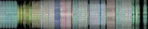
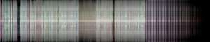
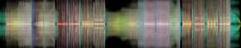
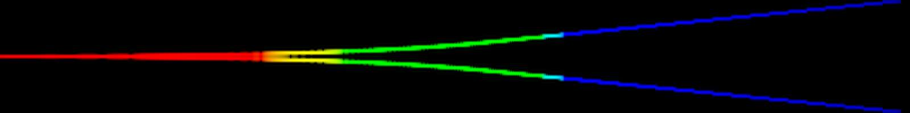
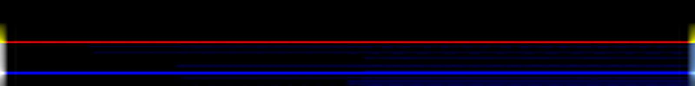

# dadaspec

Mel spectrogram thumbnails for audio files. Point it at audio, get an image
beside it.

**[DEMO](https://dada-bots.github.io/dadaspec/)** — play a track and scrub its
spectrogram. **[Palettes](https://dada-bots.github.io/dadaspec/palette.html)** —
three hard bands against a continuous hue ramp, on all six examples.

## Examples



**DADABOTS — Nuns in a Moshpit.** Section boundaries are obvious w/ color
shifts.



**The Dillinger Escape Plan — 43% Burnt.** Dense and loud throughout, so it
saturates toward white; the vertical seams are stop-start lurches.



**Zebbler Encanti Experience — Not Real.** Electronic, so the structure is
blockier: sustained bass along the centre line, quiet passages going dark
between drops.



**40 Hz → 15 kHz sweep.** Bass red at the left, rising through green to blue,
mirrored about the centre.


**White noise.** Every band at once, so it reads near-white.



**80 Hz left, 5 kHz right.** The halves disagree — this is what stereo looks
like.

## Usage

```bash
python dadaspec.py song.mp3             # writes song.jpg next to it
python dadaspec.py tracks/              # every audio file in a directory
python dadaspec.py a.wav b.wav -o out/  # into a directory instead
python dadaspec.py song.mp3 -f          # re-render an existing image
python dadaspec.py song.mp3 -W 1600 -H 200 -m 100   # bigger than the default
python dadaspec.py song.mp3 -p ramp                 # continuous hue instead of 3 bands
```

From Python:

```python
from dadaspec import render_file, render_to_jpg

render_file("song.mp3")                        # -> Path("song.jpg"), 300x60
render_file("song.mp3", width=1600, height=200, n_mels=100)
render_to_jpg(y, sr, "out.jpg")                # y is (channels, samples) or (samples,)
render_to_jpg(y, sr, "out.jpg", 1600, 200, 100)
```

## Reading the image

The top half is the left channel with bass at the bottom; the bottom half is
the right channel with bass at the top. They mirror around the centre line, so
a stereo difference shows as asymmetry and a mono file is exactly symmetric.

Brightness is per-bin dB. Hue says which band carries the energy — **bass red,
mid green, high blue** (or, with `--palette ramp`, one hue per mel bin running
red to blue with no hard boundaries — see the
[comparison](https://dada-bots.github.io/dadaspec/palette.html)) — and each band is normalised on its own, so a quiet
passage still shows colour instead of fading to black. A uniformly loud
spectrum goes white; one with only low end goes red however loud it is.

That per-band normalisation is deliberate: these are thumbnails for scanning a
list of takes at a glance, not measurement tools. Two images are comparable in
shape, not in absolute level.

## Size

Output is **300×60** by default. `--width`/`-W`, `--height`/`-H` and
`--mels`/`-m` change it, and the axes are not symmetric:

- **Width** buys real detail. Analysis runs at about 15.6 frames per second,
  so a 3-minute track has ~2800 frames to draw from and 300px throws most of
  them away. Up to one pixel per frame you resolve more; past that it
  interpolates.
- **Height** has `2 × n_mels` real rows, so the 300×60 default is exactly one
  row per mel bin per channel. A taller image only interpolates those rows
  unless `--mels` rises to match. That is the difference between a rising tone
  drawn as a smooth line and one drawn as a staircase of `2 × n_mels` treads
  — lengthening the audio only makes the treads wider, never shorter.

The examples above are 1600×200 at `--mels 100`, so every row is real.

## Details

30 mel bins by default, a 2048-point FFT at hop 2048, a Slaney-normalised filterbank
capped at 16 kHz, over audio resampled to 32 kHz. Pure numpy and Pillow — no
torch, no librosa, no scipy.

Analysis is uncentred: every frame holds real signal, never padding. A centred
STFT has to invent the ends, and the kink where that padding meets the signal
reads as broadband energy -- it lights the first and last frame white. The
trade is the final partial window, under 64 ms.

Decoding tries `soundfile`, then `ffmpeg` if it is on PATH. Enough for wav,
flac, ogg and — on any recent libsndfile — mp3.

MIT.
