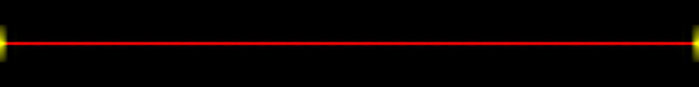
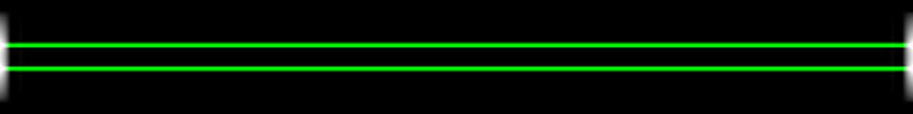
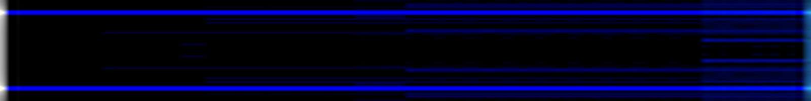
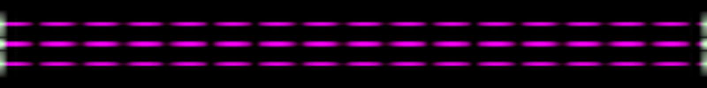

# dadaspec

Mel spectrogram thumbnails for audio files. Point it at audio, get an image
beside it.

## Real music


**The Dillinger Escape Plan — 43% Burnt.** Dense and loud almost throughout,
so it saturates toward white; the vertical seams are the stop-start lurches,
and the one dark column is the breakdown.


**DADABOTS — Nuns in a Moshpit.** Section boundaries read as hard vertical
edges, and the colour shifts where the band drops out.


**Zebbler Encanti Experience — Not Real.** Electronic, so the structure is
blockier: sustained bass along the centre line, quiet passages going dark
between drops.

## Synthetic

Each isolates one property of the encoding.


**40 Hz → 15 kHz sweep.** Bass red at the left, rising through green to blue,
mirrored about the centre.


**White noise.** Every band at once, so it reads near-white.


**80 Hz left, 5 kHz right.** The halves disagree — this is what stereo looks
like.



**60 Hz tone.** Bass only.



**800 Hz tone.** Mid only.



**6 kHz tone.** Highs only.



**100 Hz and 2 kHz together, amplitude-modulated.** Red and blue, pulsing.

## Usage

```bash
python dadaspec.py song.mp3             # writes song.jpg next to it
python dadaspec.py tracks/              # every audio file in a directory
python dadaspec.py a.wav b.wav -o out/  # into a directory instead
python dadaspec.py song.mp3 -f          # re-render an existing image
```

From Python:

```python
from dadaspec import render_file, render_to_jpg

render_file("song.mp3")            # -> Path("song.jpg")
render_to_jpg(y, sr, "out.jpg")    # y is (channels, samples) or (samples,)
```

## Reading the image

The top half is the left channel with bass at the bottom; the bottom half is
the right channel with bass at the top. They mirror around the centre line, so
a stereo difference shows as asymmetry and a mono file is exactly symmetric.

Brightness is per-bin dB. Hue says which band carries the energy — **bass red,
mid green, high blue** — and each band is normalised on its own, so a quiet
passage still shows colour instead of fading to black. A uniformly loud
spectrum goes white; one with only low end goes red however loud it is.

That per-band normalisation is deliberate: these are thumbnails for scanning a
list of takes at a glance, not measurement tools. Two images are comparable in
shape, not in absolute level.

## Details

30 mel bins, a 2048-point FFT at hop 2048, a Slaney-normalised filterbank
capped at 16 kHz, over audio resampled to 32 kHz. Pure numpy and Pillow — no
torch, no librosa, no scipy.

Output is 300×60 by default; set `SPEC_W` and `SPEC_H` for something larger.
The examples above are 1600×200.

Decoding tries `soundfile`, then `ffmpeg` if it is on PATH. Enough for wav,
flac, ogg and — on any recent libsndfile — mp3.

MIT.
